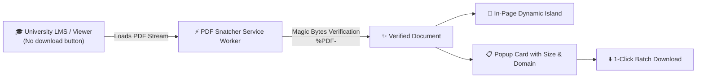

<div align="center">

# 📄 PDF Snatcher PRO

**The modern Chrome extension to intercept, unlock, and batch-download restricted PDFs from university portals and embedded viewers.**

[](https://developer.chrome.com/docs/extensions/mv3/intro/)
[](https://github.com/praneelpandey/PDF-snatcher)
[](https://github.com/praneelpandey)
[](LICENSE)

<br/>

> **Tired of university e-learning sites disabling the download button on your lecture slides?**  
> PDF Snatcher taps into low-level network streams to detect, validate, and download the raw PDF files directly from CDNs, cloud storage, and restricted viewers.

<br/>

</div>

---

## ✨ Features

- ⚡ **Deep Stream Interception** — Intercepts PDFs loaded through restricted web viewers (`<iframe>`, `<embed>`, `<object>`, Blob URLs, and Cloud CDNs like DigitalOcean Spaces, AWS S3).
- 🛡️ **Live Shield Radar** — Real-time background network monitor. When active, it displays a sleek floating Dynamic Island toast on-page when a document is detected.
- ⬇️ **One-Click Batch Download ("Download All")** — Download all lecture slides, assignment manuals, and modules from the current page simultaneously.
- 🗄️ **Vault & History** — Automatically logs captured PDFs with timestamps and file sizes in persistent storage across tabs and browser restarts.
- 🔍 **Deep DOM Scanning** — Crawls embedded frames, `data-*` attributes, and Moodle/LMS resource links on demand.
- 📏 **Payload Inspection** — Real-time file size detection and source domain extraction before downloading.
- 💎 **Luxury Dark Obsidian UI** — Apple & Linear-inspired glassmorphism with ambient radial glow, segmented pill navigation, and specular rim lighting.
- 🔒 **100% Private & Local** — Zero telemetry, zero external trackers, and no third-party servers. All processing happens locally in your browser.

---

## 🚀 Installation Guide

Installing **PDF Snatcher PRO** takes less than 60 seconds.

### Step 1: Download or Clone the Repository

Clone using Git:
```bash
git clone https://github.com/praneelpandey/PDF-snatcher.git
```
*Or click **Code → Download ZIP** on GitHub and extract the folder to your computer.*

---

### Step 2: Open Extensions in Google Chrome

1. Open **Google Chrome** (or any Chromium browser like Brave, Edge, Opera, Vivaldi).
2. In the address bar, paste and go to:
   ```text
   chrome://extensions/
   ```

---

### Step 3: Enable Developer Mode

Toggle the **Developer mode** switch in the top-right corner of the Extensions page:

```text
[ Developer mode ]  ───────>  [ ● ON ]
```

---

### Step 4: Load Unpacked Extension

1. Click the **Load unpacked** button in the top-left toolbar:
   ```text
   [ Load unpacked ]  [ Pack extension ]  [ Update ]
   ```
2. In the file dialog, select the `pdf-snatcher-chrome` folder (the directory containing `manifest.json`).
3. **Done!** PDF Snatcher PRO is now installed and ready to use.

> [!TIP]
> **Pin the Extension:** Click the puzzle icon (🧩) in your Chrome toolbar next to the address bar, then click the **Pin** (📌) icon beside **PDF Snatcher** for instant 1-click access.

---

## 🕹️ How to Use



1. **Navigate to your course portal** (e.g. Parul University e-learning, Moodle, Blackboard, Canvas, or any restricted PDF viewer).
2. **Open the lecture/document page.**
3. Click the **PDF Snatcher** icon in your toolbar:
   - View captured files with their exact size (`1.2 MB`, `4.5 MB`) and source host.
   - Click **Download** to save an individual file.
   - Click **View** to inspect it directly in a clean browser tab.
   - Click **Download All** to snatch all modules at once.
4. **Use Deep Scan**: If a portal hides documents behind dynamic JavaScript tabs, click the **🔍 Search icon** in the top-right header to scan the full DOM.

---

## 🏛️ Supported Portals & Viewers

| Platform / Service | Status | Detection Method |
|---|---|---|
| **Parul University E-Learning** | Supported | Cloud CDN & Space Interception |
| **Moodle LMS** | Supported | `pluginfile.php`, `mod/resource/` stream sniffer |
| **Canvas by Instructure** | Supported | SpeedGrader & module attachment sniffer |
| **Blackboard Learn** | Supported | `bbcswebdav` content stream listener |
| **D2L Brightspace** | Supported | `content/enforced` stream listener |
| **Embedded PDF.js Viewers** | Supported | XHR / Fetch chunk interceptor |
| **Google Drive / Docs Viewer Embeds** | Supported | Magic bytes `%PDF-` sniffing |

---

## 📂 Project Architecture

```
PDF-snatcher/
├── manifest.json        # Chrome MV3 manifest configuration
├── background.js        # Background service worker (stream interception & mutex)
├── popup.html           # Luxury glassmorphism popup interface
├── popup.css            # Dark Obsidian theme with responsive layouts
├── popup.js             # State management, batch downloader, vault sync
├── content.js           # Lightweight in-page toast injector
├── content.css          # Dynamic Island-style floating notification
└── icons/
    ├── icon16.png       # Chrome toolbar icon
    ├── icon48.png       # Extensions management icon
    └── icon128.png      # Chrome Web Store showcase icon
```

---

## 🛡️ Permissions Transparency

PDF Snatcher requests the following permissions in `manifest.json` for strictly functional reasons:

| Permission | Purpose |
|---|---|
| `webRequest` | Inspects HTTP response headers (`Content-Type: application/pdf`) to capture document URLs. |
| `downloads` | Triggers direct background downloads to your default Downloads folder. |
| `storage` | Keeps ephemeral state in `storage.session` and your persistent document vault in `storage.local`. |
| `scripting` | Executes the on-demand DOM scanner when you click the 🔍 Deep Scan button. |
| `activeTab` / `tabs` | Links captured PDFs to the specific tab you are currently viewing. |
| `<all_urls>` | Required so the extension can detect documents regardless of which university CDN hosts them. |

---

## 🛠️ Development & Customization

If you want to modify or contribute to PDF Snatcher:

1. Make edits to `popup.html`, `popup.css`, or `popup.js`.
2. Go to `chrome://extensions`.
3. Click the **🔄 reload button** on PDF Snatcher to instantly test your changes.
4. Validate JavaScript syntax before committing:
   ```bash
   node -c popup.js
   node -c background.js
   node -c content.js
   ```

---

## 🤝 Contributing

Contributions, bug reports, and feature requests are welcome!
Feel free to open an issue or submit a Pull Request.

1. Fork the Project
2. Create your Feature Branch (`git checkout -b feature/AmazingFeature`)
3. Commit your Changes (`git commit -m 'Add some AmazingFeature'`)
4. Push to the Branch (`git push origin feature/AmazingFeature`)
5. Open a Pull Request

---

## 👨‍💻 Author

Crafted with care by **Praneel Pandey**

- GitHub: [@praneelpandey](https://github.com/praneelpandey)

---

## 📄 License

This project is open-source under the **[MIT License](LICENSE)**.
Feel free to use, modify, and distribute it for academic and personal use.
